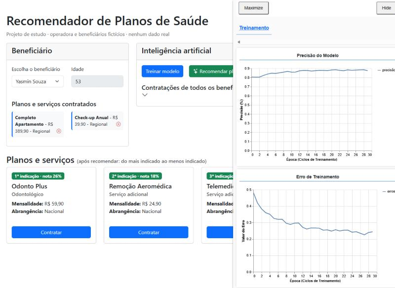

# Recomendador de Planos de Saúde

Projeto de estudo da pós em **Engenharia de Software com IA Aplicada** (Disciplina 01, Módulo 3).
Uma rede neural que **indica planos e serviços de saúde** para cada beneficiário, rodando 100% no navegador com **TensorFlow.js**.



> **Créditos:** construído a partir do projeto de sistema de recomendação da disciplina *Fundamentos de IA e LLMs para Programadores*, do prof. **Erick Wendel**, na pós-graduação da UNIPDS.
> Código-base original: [unipds-engenharia-de-ia-aplicada/engenharia-de-software-com-ia-aplicada](https://github.com/unipds-engenharia-de-ia-aplicada/engenharia-de-software-com-ia-aplicada), sob a licença [CC BY-NC-ND 4.0](https://creativecommons.org/licenses/by-nc-nd/4.0/).
> **O que mudou em relação ao original:** os dados (planos e beneficiários fictícios), o "cérebro" da recomendação (peso da idade, treino só com idade, regras de negócio), a tela em português e os ajustes descritos na seção 3.

> ⚠️ **Todos os dados são fictícios.** A operadora, os planos, os preços e os beneficiários foram inventados.
> Dados reais de beneficiários (e principalmente de saúde) são **dados pessoais sensíveis pela LGPD** e **não devem** ser usados em projetos de estudo.
> Este projeto também **não usa nenhum dado de saúde**: só idade e os planos contratados.

---

## 1. Como rodar

Precisa ter o **Node.js** instalado.

1. Abra esta pasta no VS Code.
2. Abra o terminal (**Terminal → New Terminal**).
3. Só na primeira vez: `npm install`
4. Rode: `npm start`
5. O navegador abre em **http://localhost:3100**. Se não abrir, digite o endereço no Chrome.

Para parar: clique no terminal e aperte **Ctrl + C**.

> Se o Chrome oferecer **traduzir** a página, recuse. A página já está em português, e a tradução automática bagunça os gráficos.

## 2. Como usar a tela

1. Clique em **Treinar modelo** e espere o botão voltar ao normal (de 10 a 30 segundos).
   No painel da direita aparecem dois gráficos: a **precisão** subindo e o **erro** caindo.
2. Em **Escolha o beneficiário**, selecione alguém.
3. Clique em **Recomendar planos**.
4. A lista de planos é reordenada: o primeiro é a **1ª indicação**, e cada cartão mostra a **nota** que a rede deu.

Teste estes dois casos:
- **Novo beneficiário (sem plano, 60 anos)**: deve receber planos e serviços comuns nessa idade (Sênior, Check-up...).
- **Um beneficiário que já tem plano**: recebe só **serviços complementares** (odonto, telemedicina, check-up...).

Você também pode clicar em **Contratar** em algum plano para um beneficiário, **treinar de novo** e ver a recomendação mudar.

---

## 3. Como funciona (em linguagem simples)

A ideia é a mesma de "quem comprou isso também gostou daquilo".

```
 Beneficiários que já existem         A rede neural estuda           Para uma pessoa escolhida
 (idade + planos contratados)   →    os padrões (treino)       →    dá uma nota para cada plano
                                                                     e mostra do maior para o menor
```

Tudo acontece no arquivo **`src/workers/modelTrainingWorker.js`**, em 7 etapas (cada uma está comentada no código):

| Etapa | O que faz | Exemplo |
|---|---|---|
| **1. Configurações** | Define a importância de cada característica (pesos) | segmento vale mais que mensalidade |
| **2. Contexto** | Calcula faixas de idade e preço, e a idade média de quem contrata cada plano | o "Sênior Completo" é contratado por quem tem ~65 anos |
| **3. Plano → números** | Transforma cada plano numa lista de 9 números | segmento e abrangência viram "interruptores" (one-hot) |
| **4. Beneficiário → números** | Transforma a pessoa numa lista do mesmo tamanho | média dos planos que ela tem + a idade dela |
| **5. Exemplos de treino** | Junta cada pessoa com cada plano e diz: tem (1) ou não tem (0) | igual ao Titanic: sobreviveu (1) ou não (0) |
| **6. Treinar** | A rede ajusta os pesos internos para errar cada vez menos | 30 voltas nos dados (epochs) |
| **7. Recomendar** | Pede a nota de cada plano, aplica as regras de negócio e ordena | não indica o que a pessoa já tem |

### Da loja (aula) para os planos (este projeto)

O código da aula foi reaproveitado. Os nomes dos campos continuam os mesmos, só o significado mudou:

| Na loja da aula | Neste projeto | Valores |
|---|---|---|
| produto | plano ou serviço | 12 itens |
| `category` (categoria) | **segmento** | Ambulatorial, Completo, Odontológico, Serviço adicional |
| `color` (cor) | **abrangência** | Municipal, Regional, Nacional |
| `price` (preço) | **mensalidade** | R$ 19,90 a R$ 549,90 |
| cliente | **beneficiário** | 60 pessoas fictícias |
| `purchases` (compras) | **planos contratados** | |

### O que foi melhorado em relação à aula

Ao testar com os dados de planos, apareceram problemas que a loja da aula também tinha. Cada um foi corrigido:

| Problema encontrado | Por que acontecia | O que foi feito |
|---|---|---|
| A rede **decorava** quem tinha o quê, e todo o resto ficava com nota 0% | Poucos dados (só 8 pessoas) e treino longo demais | Base com **60 beneficiários** e treino de **30 voltas** (antes eram 100) |
| A **idade** quase não influenciava (pessoa de 60 anos não recebia o plano Sênior) | Na aula, a idade tinha peso 0,1 e ficava "escondida" na média | A idade do beneficiário entra com **peso 1,0** |
| Novos beneficiários recebiam indicações sem sentido | A rede nunca tinha visto, no treino, alguém "só com idade" | Cada pessoa entra no treino **duas vezes**: com o perfil completo e **só com a idade** |
| Indicava o plano que a pessoa **já tinha** | A aula não filtrava | Filtro: não indicar o que já foi contratado |
| Indicava um **segundo plano principal** para quem já tem plano | Regra de negócio que a rede não conhece | Quem já tem plano principal recebe só **serviços complementares** |

### Ajustes na tela (encontrados nos testes)

| Problema | Correção | Arquivo |
|---|---|---|
| Depois de **Contratar**, o plano continuava aparecendo como indicação | As indicações se atualizam na hora, ao contratar ou cancelar | `src/controller/UserController.js` |
| Preço na lista de contratados aparecia "R$ 19.9" | Formato brasileiro: "R$ 19,90" | `src/view/UserView.js` |
| Quem já tinha tudo via a área de planos **vazia**, sem explicação | Mensagem: "já tem todos os planos e serviços..." | `src/view/ProductView.js` |
| Durante o treino, **Recomendar planos** ficava ativo, mas não fazia nada | O botão fica desativado enquanto treina | `src/view/ModelTrainingView.js` |
| Depois de treinar de novo, era preciso clicar em recomendar outra vez | As indicações se atualizam sozinhas ao fim do treino | `src/controller/ModelTrainingController.js` |
| O treino era lento | As listas de números dos planos são calculadas uma vez só | `src/workers/modelTrainingWorker.js` |

### Testes realizados

| Cenário | Resultado |
|---|---|
| Novo beneficiário, 60 anos | 1º Check-up, depois Completo Apartamento, Sênior e Remoção. Ambulatoriais (planos de jovens) por último ✅ |
| Beneficiário de 20 anos com plano | Só complementos: Telemedicina e Odonto Básico no topo ✅ |
| Beneficiários de 41, 53 e 68 anos com plano | Só complementos, na ordem que combina com a idade ✅ |
| Contratar um complemento | Sai da lista na hora e é salvo sem a "nota" ✅ |
| Cancelar (clicar no item contratado) | Volta para a lista de indicações ✅ |
| Novo beneficiário contrata um plano principal | Passa a receber só complementos ✅ |
| Contratar tudo | Mostra a mensagem de "nada a recomendar" ✅ |
| Treinar de novo com os dados alterados | Botão de recomendar desativado durante o treino, e indicações atualizadas no fim ✅ |
| Console do navegador (F12) | Nenhum erro ✅ |

**Sobre as notas:** para quem já tem plano, as notas dos serviços complementares costumam ser **baixas** (5%, 13%...). Isso é esperado: a rede foi treinada vendo que essas pessoas **não** têm esses serviços. O que importa é a **ordem**: a 1ª indicação é a que mais combina com o perfil.

---

## 4. Mapa dos arquivos

```
M03-recomendador-planos-saude/
├── index.html                  a página (textos da tela)
├── style.css                   aparência
├── package.json                configuração do projeto (porta 3100)
├── data/
│   ├── products.json           CATÁLOGO: os 12 planos e serviços (fictícios)
│   └── users.json              BENEFICIÁRIOS: 60 pessoas fictícias e o que contrataram
├── tools/
│   └── gerar_beneficiarios.py  gera o users.json com padrões por faixa de idade
└── src/
    ├── index.js                liga todas as peças ao abrir a página
    ├── workers/
    │   └── modelTrainingWorker.js   ← O CÉREBRO: as 7 etapas da IA (comentado passo a passo)
    ├── view/                   o que aparece na tela (cartões, botões, gráficos)
    ├── controller/             recebe os cliques e chama quem resolve
    ├── service/                lê os dados (planos e beneficiários)
    └── events/                 nomes das mensagens trocadas entre as partes
```

Para entender o projeto, leia nesta ordem:
1. este README;
2. `data/products.json` e um trecho do `data/users.json`, para ver os dados;
3. `src/workers/modelTrainingWorker.js`, de cima para baixo, seguindo as etapas 1 a 7.

## 5. Como mudar o projeto

| Quero... | Onde mexer |
|---|---|
| Adicionar ou mudar um plano | `data/products.json` (depois gere a base de novo, abaixo) |
| Gerar outra base de beneficiários | `tools/gerar_beneficiarios.py` (padrões por idade) → rodar `python gerar_beneficiarios.py` dentro da pasta `tools` |
| Mudar o que é considerado "parecido" | `WEIGHTS` no início do worker (etapa 1) |
| Mudar o peso da idade | `USER_AGE_WEIGHT` (etapa 1) |
| Mudar quais segmentos são "plano principal" | `PLANOS_PRINCIPAIS` (etapa 1) |
| Treinar mais ou menos | `epochs` (etapa 6) |

> A tela guarda os beneficiários na memória da aba. Depois de mudar o `users.json`, **feche a aba e abra de novo** para carregar os dados novos.

## 6. Limitações (projeto de estudo)

- Os padrões da base foram **inventados** por faixa de idade. A rede aprende exatamente esses padrões, e por isso as indicações parecem "certas".
- Uma operadora real teria muito mais informações, como região, dependentes, tipo de contrato e histórico, e precisaria de **aprovação jurídica e de privacidade (LGPD)** para usá-las.
- Os resultados mudam um pouco a cada treino, porque a rede começa com pesos aleatórios.

## 7. Próximos passos possíveis

- Acrescentar **região** e **número de dependentes** do beneficiário.
- Usar um **banco vetorial** para catálogos grandes (Módulo 10 da disciplina).
- Explicar a recomendação ("indicado porque pessoas da sua faixa de idade costumam contratar...").
